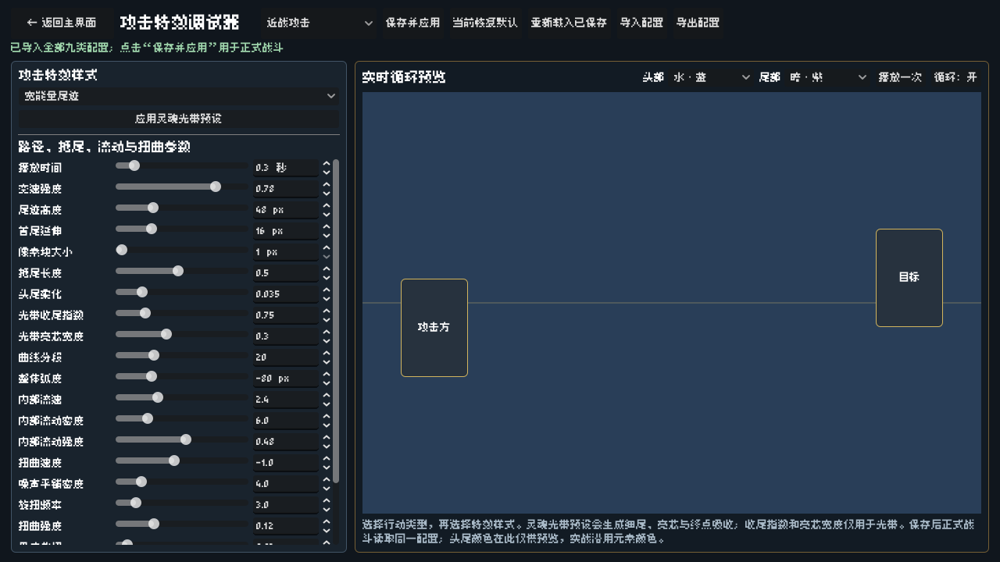
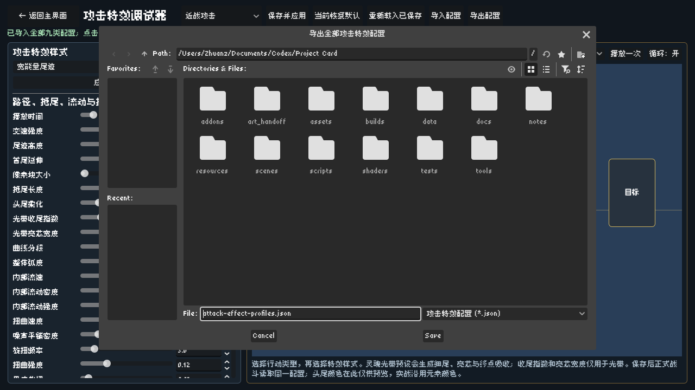

# 攻击特效配置交换与十卡平衡（2026-10-13）

本轮在主项目 `main` 上完成；未创建分支或工作树。依据用户本轮十项平衡指令，以及警戒机械“仅受伤唤醒时发一次”的回复。原飞书和ZIP读回快照保留历史内容，当前规则以 `CARD_CHARACTER_DESIGN.md` 本轮取代段、卡牌资源与效果定义为准。

## 使用流程

攻击特效调试器顶部新增“导入配置”“导出配置”，原保存改为“保存并应用”。导出会保存全部九类特效的当前草稿，包括还没点击保存的修改。收到另一台机器的JSON后导入，即可查看参数和实时预览；点击“保存并应用”后，正式战斗使用这些参数。

JSON包含格式标记、版本号1、九类配置；每类有样式及22个数值参数。它不记录仅用于演示的头尾元素颜色选择。默认导出名称为 `attack-effect-profiles.json`。当前电脑的正式配置仍保存到原 `user://battle_attack_effects.cfg`，不破坏已有配置。九类配置缺失、类型错误、数值越界、分段为小数或版本不支持时，显示错误并保留原草稿与正式配置。

## 第一层：从输入到结果

特效参数和JSON先进入调试器草稿；控件与实时预览读同一份草稿。导出只写文件，导入只替换经完整校验的草稿。保存成功后才替换正式战斗配置，写盘失败不会先改变内存配置。战斗诊断记录开战时完整特效参数，避免再次缺少合作伙伴的弹道配置。

卡牌平衡同时修改卡面短文、独立CardData资源和实际执行逻辑。真实正数伤害统一经 `BattleSquadState.apply_damage_exact()` 发出信号：雷暴步兵加热诚并转换，警戒机械只消费自身初始休眠一次。突击／回响／遗愿继续走通用效果队列；定时装备继续使用战斗逻辑时钟。没有新增战斗循环，也不靠视觉动画回调结算。

## 第二层：主要数据与职责

- `scenes/tools/AttackEffectLab.tscn`、`scripts/tools/attack_effect_lab.gd`：特效页面、文件窗口、草稿、控件和实时预览。`_import_profile_file()`完整验证后更新草稿，`_export_profile_file()`导出全部草稿。
- `scripts/battle/battle_attack_effect_profiles.gd`：九类默认值、参数范围、JSON版本与正式配置入口。`read_profile_file()`检查文件；`save_profiles()`写入成功才应用。重载方法改名为 `reload_profiles()`，避免与预加载Script资源原生的 `reload()`重名。
- `resources/cards/`：十张卡的名称、行动方式、等级、短文及效果ID；保留用户此前调整的基础数值与美术偏移。侦察员复用现有 `scout`／“侦查员”，没有另建同名卡。
- `data/demo2/ironwall_effects.json`：军阵指挥官增加遗愿，侦查员改回响，删除警戒机械旧遗愿；`silvermoon_effects.json`添加树人突击；`ash_ledger_effect_samples.json`取消诗人非衍生限制，并明确要求来源存活。
- `scripts/battle/ironwall_runtime.gd`：真实受伤反应、10热诚转换、30秒初始休眠、10秒吊坠周期，以及回收相邻强化。回收监听从修复初始化中移出，死亡退场和布局刷新后再读取当前邻居；阿诺修复必须先确定是否保留占位，因此两项不能混在同一个钩子里。
- `scripts/battle/silvermoon_runtime.gd`：树人只临时改写最左端有效符文槽，立即换算新冷却秒数，不改收藏符文；移除旧木符文附加暗收益光环。未揭晓槽不会免费揭晓。
- `scripts/data/squad_data.gd`：列阵步兵每张+1行动数值/+1生命，单兵不加成，物理遮挡不取消加成。
- `scripts/data/ordinary_shop_service.gd`：旧治疗类树人商品和旧III级吊坠报价仍可读档。仅用资源副本验证两张卡已经确认的历史属性，新生成候选始终使用当前定义；其他未知分类／提示继续拒绝。
- `scripts/data/owned_card.gd`的 `set_acquired_action_type()`：读档、商品预览及购买时，固定行动跟随当前定义，多行动卡保留仍合法的已确定结果；不重投随机数。避免旧商品或旧拥有实例把树人重新改回治疗。
- `scripts/battle/battle_diagnostic_recorder.gd`：诊断settings新增开战时九类特效完整配置和文件版本。

用户本轮补充确认诗人和回收“只在自身存活时监听”，自身死亡不触发，阵亡后停止监听；诗人计入友方衍生物，回收计入双方及衍生造物。军阵遗愿使用死亡前邻居快照；警戒同排保护包括仍存活的自身，自然醒来和醒后再受伤不发保护。保护完全挡伤、落空和零伤害不触发两张卡的受伤效果。

## 第三层：容易困惑的Godot写法

`signal`是节点／资源之间的通知。这里由真实扣血扣甲入口发出 `damage_taken`，卡包运行时连接信号处理效果；结束战斗时断开连接，避免旧战斗继续响应。

`static func`让正式战斗和调试器通过同一个类访问配置。`duplicate(true)`深复制嵌套字典，用来隔离草稿、候选配置和诊断快照，防止拖滑块就提前修改正式战斗。只在完整校验或写盘成功后替换字典，导入错误不会造成半份配置被应用。

`FileDialog.file_selected.connect(...)`把用户最终选中的路径交给导入／导出函数。`ACCESS_FILESYSTEM`允许选择资源目录以外的文件，Windows和macOS都沿用Godot原生文件窗口。`StringName`用于稳定的卡牌／特效ID，显示文本用普通字符串。

## 验证记录

全部Godot进程串行运行，显式使用 `/private/tmp/project-card-*.log`；未升级Godot、添加第三方依赖或导出Windows安装包。

- 特效JSON与界面入口：无窗口231项通过，图形模式另含2项截图检查，共233项通过；九类全部参数往返，错误文件、导入失败及写盘失败覆盖。
- 铁壁战斗：381项通过。覆盖正数护甲伤害、保护挡伤、独立伤害、雷暴阈值、30秒自然醒来、受伤唤醒单次、军阵双侧遗愿、同批造物死亡、双方造物监听及旧效果移除。
- 银月战斗：469项通过，覆盖树人近战、仅最左端转换、原符文不写回、新冷却换算及旧光环撤除。
- 悲歌诗人专项：5项通过，覆盖普通／衍生友军、自己不成长、自身死亡及死后不继续监听。
- 平衡旧存档兼容：11项通过；卡牌经济：42项通过；D2-5本局存档回归：13项通过。普通商店完整回归通过；旧用例已更新为三个开放卡包，并修正把枪械大师奖励武器误当作购买主卡的取值。
- 战斗诊断导出：18项通过，JSON往返保留全部特效配置；为保证确实覆盖UI日志上限，测试使用独立高生命、低数值的民兵副本，不修改正式卡牌资源。
- 原中毒调度故障入口：9项通过。新版伙伴场次回放：16种帧率／倍速／暂停组合，75项通过，全部正常结束。新平衡改变了选敌和触发顺序，因此不再要求命中旧版本的10.196秒特定死亡时刻；旧故障的“0生命但alive仍为true”边界由最小调度回归直接覆盖。原始及补充弹道参数的区别仍在夹具中注明。
- `git diff --check`通过。

旧D2-4综合测试另有9项失败，涉及符文刻匠旧行动倍率、火枪手旧受击优先级、标枪／光折射及随军医者旧用例；没有将该综合测试报告为通过，本轮仅对诗人相关用例验收。部分包含Main场景的既有测试退出时仍打印ObjectDB／资源残留警告；这不等于所有测试都干净。
