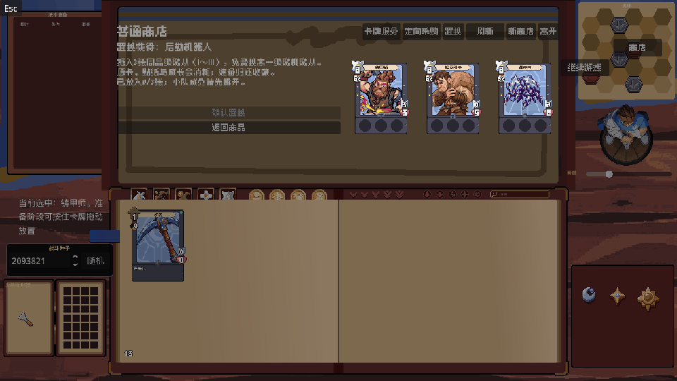

# D2-8 置换槽交互与动画修订（2026-10-15更新）

## 一、整体流程

槽内悬停保留一张真实卡面，不附加偏移阴影或旋转。卡面从收藏或战场移入服务槽时，先清理旧的轻晃、抽出与小队反馈。原小队仍保留与该CardView的信号绑定，但暂存期间不再驱动它的位置和悬停；归还后继续使用原节点与原绑定。

单击携带仍使用既有CardDragPreview。此前服务槽的落点判断在函数开头返回，跳过了预览位置更新；现在先更新卡图位置，再判断是否可归还收藏。原生长按路径继续复用Godot拖拽预览。

置换确认的顺序为：校验材料和产物资格→读取材料显示位置→提交三卡消耗、装备返还和新卡生成→保存→播放演出。保存失败仍回退全部数据，不开始演出。

成功演出约2.69秒：

1. 材料从三个槽放大至原图2倍，在0.34秒内移到屏幕中央并排，卡边间距80逻辑像素，居中停留0.12秒。
2. 两侧卡保持原色，在0.12秒内各向外回撤原图12像素（2倍显示为24逻辑像素），然后用0.35秒从慢到快撞向固定中间卡。前冲时间经过55%时才开始用0.06秒迅速变白，重合融合0.05秒。
3. 材料退场，新卡以白色剪影出现，此时十字闪点立即出现并独立向左右外侧展开、略微上飘，在0.20秒内淡出。新卡0.10秒恢复原色，0.24秒从2倍扩大至4倍；闪点独立于新卡节点，不随新卡放大或飞入收藏。不使用径向大片白光。
4. 新卡在中央停留0.65秒，便于查看。
5. 新卡在0.50秒内缩小并飞回收藏。当前页存在产物卡位时，保持不透明，飞到卡位中心并缩回正常大小；产物不在当前页时，缩小飞入书本并淡出。
6. 整本收藏以递减水平幅度抖动约0.315秒，最后回到原位置。

演出期间拦截输入，重复确认不能再获得卡牌。新卡拥有数据已经保存，只暂时隐藏当前页对应卡位，飞回落地时再显示；不修改新卡绿点、不重新抽结果。程序化关闭、还原或读档会清理临时视觉，已提交结果保留。

演出任意阶段连续点击左键可以加速，和纹章合成共用同一个组件：两次按下间隔不超过0.32秒时，每次增加1.5倍，最高8倍。首个单击不提速，右键不计入加速；每场新演出从1倍开始，连点不会重复置换或改变随机结果。

## 二、脚本与数据职责

- `scripts/ui/card_service_slot.gd`：搬入原卡面前清理来源反馈，继续记录归还地址；强化、原商店服务和三卡置换共用。
- `scripts/ui/card_view.gd`：服务槽来源的悬停不绘制偏移阴影，也不播放旋转。收藏和普通战场的反馈沿用原行为。
- `scripts/ui/squad_view.gd`：通过已有`card_service_slot`标记识别暂存卡；不响应其旧小队点击／悬停，不再向该节点写入小队抽出位移。
- `scripts/main.gd`：先更新单击携带预览，再处理服务槽落点。`_execute_shop_exchange()`在存档成功后调用`_play_shop_exchange_animation()`；`_shop_exchange_animation`引用活动演出，用于防重复与收尾。收藏空卡位查找先检查是否存在`owned_card`标记，避免空位置产生元数据错误。
- `scripts/ui/card_exchange_animation.gd`：独立负责2倍并排、变白回撤、两侧撞合、4倍展示、十字闪点、飞入与书本抖动。将复杂卡面通过现有CardSnapshotVisual压成整卡纹理，临时快照只用于展示，不代表第二张拥有卡牌。动画没有卡池、金币或随机数修改职责。
- `shaders/emblem_fusion_white.gdshader`：复用纹章演出的白色剪影Shader，挂在每张整卡快照的纹理上；卡牌、越界图标与透明轮廓一起变白，每张快照使用独立ShaderMaterial，互不改色。
- `scripts/ui/animation_click_speed.gd`：从纹章脚本抽出的共用连点逻辑，统一保存阈值、增量与上限；纹章和三卡各自持有一个实例，倍率互不串用。
- `scripts/ui/emblem_fusion_sparks.gd`：直接复用纹章的两枚像素十字闪点；只在置换演出实例上放大3倍，使闪点分布在新卡两侧，纹章原演出不受影响。

CardServiceSlot保管真实输入卡，现有演出Control管理中央视觉与整本收藏抖动。本轮直接替换原白光阶段，沿用原生Tween、整卡快照和纹章Shader，没有新增美术位图、插件或依赖。临时节点在结束时释放。

人工可调的尺寸、倍率、时长和抖动幅度集中在演出脚本顶部，均有同排中文说明。其他CardData／OwnedCard及价格规则不受本轮展示修改影响。

主要参数：`MATERIAL_SCALE=2`、`MATERIAL_GAP=80`控制并排大小和间距；`PULLBACK_PIXELS=12`按原图像素控制向外回撤；`ARRANGE_SECONDS`控制放大入场，`PULLBACK_SECONDS`控制回撤，`COLLIDE_SECONDS`控制撞击，`WHITE_START_PROGRESS`与`WHITE_SECONDS`控制临近撞击才变白，`FUSION_HOLD_SECONDS`控制重合停留，`REVEAL_SECONDS`控制恢复原色，`EXPAND_SECONDS`控制扩大至4倍，`SPARK_SECONDS`控制闪点外飘与消散，`SPARK_SCALE=3`控制十字闪点大小及分布范围。原`DISPLAY_SCALE=4`、`FLY_SECONDS`、`BOOK_SHAKE_OFFSET`与`BOOK_SHAKE_STEP`继续控制展示、归位与收藏震动。

## 三、需要理解的Godot写法

- `Tween.parallel()`：让当前阶段的多个属性一起变化，例如三卡位置和缩放一起变化、新卡恢复原色和放大一起播放。普通后续`tween_property()`则继续串行，让飞入结束后才开始书本抖动。
- `RefCounted`共用组件不需要挂在场景树中，演出结束后自动释放；它只通过`Tween.set_speed_scale()`调整播放，不接触库存。纹章每次新建Tween时调用`apply_to()`继承本次已经积累的速度，确认和取消交接也不会丢失倍率。
- `_collide_materials(progress)`用`progress * progress * progress`把线性时间转换为加速位移；`index - 1`为左、中、右卡分别产生-1、0、1的对称偏移，因此中间卡不会被推离中心。
- 回撤距离乘`MATERIAL_SCALE`，因此原图12像素在2倍演出中为24逻辑像素。撞击的起点也加上同一距离，后退结束切换到前冲时不会跳回原并排位置。闪点只调用`set_progress(0→1)`驱动既有绘制，不产生新的拥有卡或随机数。
- `get_global_transform_with_canvas().affine_inverse()`：材料来源使用画布坐标，演出节点使用本地坐标；反变换把来源中心准确换到演出坐标，避免显示模式缩放时出现位移。
- CardSnapshotVisual使用SubViewport合成纹理，使越界的行动、生命等图标随整卡一起缩放。4倍指99×136裸卡的逻辑尺寸，外围图标随其一起放大。
- `signal landed`：飞回落地时交接到当前页真实卡面。`signal finished`：演出组件通知Main恢复收藏卡位并清空活动引用。`queue_free()`在帧末释放临时节点，`_exit_tree()`还原书本位置，防止中断时留下偏移。
- `has_meta()`：当前收藏页有占位空容器，不是每个容器都对应拥有卡；先检查标记存在，再读取实例，避免Godot对空元数据报错。

## 验证

2026-10-15新增共用连点加速后，正式窗口专项58项全部通过。追加真实左键检查单击不提速、连点2.5倍、实际Tween推进速率、8倍上限、整场加速后正常落地、右键不误触发、新演出恢复1倍及不重复结算。日志为`/private/tmp/project-card-exchange-shared-click-speed-verified.log`。播放速率以实际墙钟时间与`get_total_elapsed_time()`增量对比验证，依据[Godot Tween累计时间说明](https://docs.godotengine.org/en/stable/classes/class_tween.html#class-tween-method-get-total-elapsed-time)。

2026-10-15按原纹章GIF逐帧调整节奏后，实际窗口动画专项50项全部通过，覆盖2倍并排、80像素间距、原图12像素回撤、前半程原色、临近碰撞变白、白色结果与移动闪点同时出现、100毫秒恢复颜色及既有归位。日志为`/private/tmp/project-card-exchange-gif-motion-verified.log`。固定测试随机种子，避免随机抽到附送装备的卡使原库存数量断言受额外获取效果影响；未修改正式随机流程。

本轮2K收藏落点回归28项全部通过，日志为`/private/tmp/project-card-exchange-gif-placement.log`；合计78项，进程串行执行并均退出0。录制了77帧真实游戏画面，核对十字闪点独立向左右外侧和上方移动、淡出，未用新卡缩放代替闪点位移。

当前截图：[2倍并排](previews/card-exchange-three2x-20261015.png)、[原色回撤](previews/card-exchange-pullback-20261015.png)、[移动十字闪点](previews/card-exchange-sparks-20261015.png)。下方为实际演出录像，后续2026-10-14验证与截图保留为历史记录。

2026-10-14原生窗口专项使用正式GameDisplay和真实鼠标输入，43项通过：原有服务槽交互、保存失败回退、3倍居中对称并排、原色转白、两侧从慢到快撞入固定中间卡、白色剪影融合、新卡恢复原色并扩大至4倍、缩小飞入、收藏震动、重复确认、Esc输入阻止及存档读回。日志为`/private/tmp/project-card-exchange-white-fusion-verified.log`，无脚本错误。

随后运行现有真实2K服务放置回归，28项全部通过，覆盖当前页真实卡位中心与大小、落地交接、只保留一张真实产物、原生拖放和服务退出。日志为`/private/tmp/project-card-exchange-white-placement.log`。两项合计71项，Godot进程串行执行并均退出0。

当前实际截图：[3倍居中并排](previews/card-exchange-three3x-20261014.png)、[纯白剪影融合](previews/card-exchange-white-fusion-20261014.png)、[新卡4倍展示](previews/card-exchange-result4x-20261014.png)。

测试读取初始Shader参数时，如果材质尚未覆盖uniform，就查询渲染器中的真实默认值；未通过硬编码值替代实际参数。依据[Godot RenderingServer官方接口](https://docs.godotengine.org/en/stable/classes/class_renderingserver.html#class-renderingserver-method-shader-get-parameter-default)。

原生截图已检查3倍并排、纯白剪影重合、新卡恢复原色、4倍展示和飞入状态。下方既有经济与服务专项记录属于历史验证；本轮只运行相关界面专项，不是全量测试。

现有商店追加界面24项与卡槽／数字／回位专项48项均通过。72张收藏负载下，出售约9.0毫秒、撕卡约9.4毫秒；两次读档仍约59.4～62.6毫秒的一次性帧停顿。本次记录不能表述为所有步骤均无卡顿。

测试入口：`tests/d2_8_exchange_animation_ui_test.gd`，复用前轮专项的真实鼠标和收藏操作工具，独立检查演出阶段，没有修改原有断言来绕过新增展示行为。

## 五点截图反馈修正

- 指示物底板和库存挂入 `WorldContent`，世界坐标为 `(1080,860)`。收藏视角平移后落在屏幕 `(1080,500)`；切换到战场时仍保留世界位置，库存不会随屏幕移到人物下方。
- 融合快照使用1倍原生渲染，SubViewport内部和输出纹理均使用最近邻采样。此前内部2倍渲染默认线性过滤，先产生模糊边缘，外层再用最近邻放大也无法恢复。检视同样采用原生像素渲染和最近邻采样；不需要启动可交互检视界面。
- `Main._is_card_service_active()`统一识别融合、商店单卡服务和事件强化。开启时关闭战场、法术与资源部署，保留收藏和战场的合法单卡拾取、归还；点击携带也先判断服务状态，不创建战场预留位。关闭服务恢复正常部署。
- `CardServiceSlot`仍保管原来的真实CardView，`_source`保存归还地址，`_source_ghost`只显示收藏来源虚影。虚影使用快照模式，不能拾取、悬停或消除新卡标记；重建收藏页时重绑来源并重建虚影，归还或消耗材料时释放。
- 入槽直接复用 `CardView.animate_from_global_position()`；有拖拽预览时从实际释放卡面位置开始，以父节点的画布逆变换换算成槽内位置，沿用已有平滑Tween。
- 当前页归位目标由真实收藏卡的画布变换计算，读取其实际中心与缩放。`landed`信号让Main在飞回落地时显示真实卡，随后只播放书本抖动；演出不修改拥有权、实例属性或随机状态。

新增专项 `tests/d2_8_service_placement_regression_test.gd`，复用正式显示壳与真实鼠标输入，最终28项通过。覆盖世界定位、点击和原生长按不能误放战场、入槽移动、来源虚影、收藏重建、原生归还、像素采样、当前页精确落点及大小、强化退出恢复部署。720p实际窗口26项通过；追加原生长按入槽与单次虚影透明度检查后，2K实际窗口28项通过；截图检查了大卡清晰度、虚影和最终卡位。现有融合动画专项35项通过。

旧商店追加界面和服务动画专项中的“来源为空”和“战场视角指示物板始终屏幕可见”断言记录的是本轮之前的要求，已被本次用户截图要求取代；本轮未改写这些历史断言，也未执行全量测试。

## 拖拽入槽时序与战场来源修正

强化选择会重建面板，Container在帧尾才完成位置分配。此前先在尚未排版的父容器里计算起点，容器随后移动，导致卡面从右侧补飞。现在先读取预览的画布位置，再刷新面板；真实卡以`set_as_top_level(true)`暂时停在松手处，等待一帧排版后恢复父节点坐标并播放已有Tween。融合与卡牌服务共用同一流程。

Godot原生拖拽结束时，预览可能在`NOTIFICATION_DRAG_END`之前已离树或释放；此时再查询预览坐标或来源SubViewport鼠标坐标，可能得到零点附近的局部值。不同结束时序解释了偶发左上角闪现。CardDragPreview逐帧保存最后可见位置，并在`tree_exiting`时交给CardView和BattlefieldRow；结束通知使用保留的位置，不再依赖已释放预览。收藏归还等待排版时同样停在释放位置，悬停抽出在移动完成后恢复，避免抢写`position`或终止Tween。

BattlefieldRow的`_drag_enabled`负责来源抓取，`_drop_enabled`负责部署接收。此前服务状态把两者一并关闭，战场卡无法进入服务；现在允许拾取、禁止部署。SquadView仍保存原实例与信号绑定，但暂存期间跳过该卡的隐藏、排序、层级、位置与输入来源写入。否则小队刷新会隐藏槽内卡，或尝试重排已经移走的子节点。关闭服务将同一CardView归还原小队，不新增OwnedCard。

新增`tests/d2_8_service_entry_timing_test.gd`使用正式GameDisplay、真实鼠标输入和原生拖拽，逐帧检查路径与最终坐标：重复融合成功入槽及槽外松手、强化重建后的入槽、战场卡进入三种服务、点击携带、退出归还与部署权限。无窗口与真实2K窗口各92项通过；无窗口仍有既有macOS证书和退出资源清理日志。

本轮追加真实2K窗口回归：服务放置28项、既有融合演出35项均通过，并检查来源虚影及产物回到当前页正常卡位的截图；未运行全量测试。
