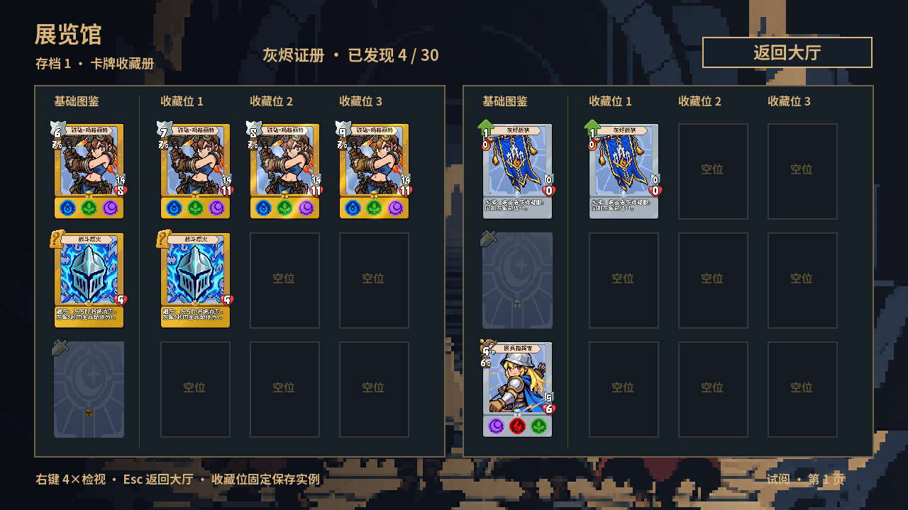

# D3-3首张收藏册实现与预览

后续状态：用户已确认本稿的双页样式，并授权接入完整目录、卡包分类、筛选和翻页，现已实现与验证，见[完整收藏册说明](D3_3_COMPLETE_BOOK_IMPLEMENTATION.md)。下文保留首版交付时的范围和原始实拍。

日期：2026-11-03。首张双页已接通和验证，供用户查看排版；完整展览馆仍在后续范围，不能把这一页写成D3-3整体完成。只在主目录、main工作，未创建分支、worktree、子代理，未提交或推送。学习问答和练习继续暂停。

## 已交付的一页

存档内大厅的“展览馆”现可进入首张双页，顶部按钮或Esc返回本档大厅。左右各三行，每种一处基础图鉴加同排三个固定收藏位，卡面原生99×136；按主要卡包、品级降序、同品级稳定ID排序。首版只展示灰烬证册的前六种；若本档未开放灰烬则展示首个已开放正式卡包的前六种，没有开放卡包时显示空目录。

当前没有翻页、滚动、筛选和卡包选择器，底部标为“试阅·第1页”。先确认这一页的尺寸、三行密度、书脊和列间留白，再扩展完整目录；本轮没有资源、贴纸及衍生预览，也没有提前开放D3-4任务商店。所有首版排版参数都是可逆原型，不作为用户已确认的界面规格。

[2K实际双页](previews/d3_3_20261103/01_book_2k.png) · [悬停透视](previews/d3_3_20261103/02_hover_2k.png) · [实际实例4倍检视](previews/d3_3_20261103/03_inspection_2k.png) · [新档未知状态](previews/d3_3_20261103/04_new_profile.png)

截图来自真实Godot 4.7.2 Steam／Apple M4 GPU。为了同时展示未知、已发现、空位和收藏实例，测试通过正式`finish_run → show_selection → set_selection → show_preview → confirm_collection`生成隔离临时档；未把测试发现或收藏写进玩家存档。预览使用正式卡牌资源，实例包含不同外观、永久成长、获得时间／来源／征召英雄及累计战绩。

## 从输入到结果

1. 大厅发出`gallery_requested`，`GameDisplay`复用现有转场，隐藏大厅并创建独立`GalleryBook`，传入当前档`ProfileProgress`。
2. 目录读取本档开放卡包与永久发现；未发现基础卡只创建背景、种族／类别和适用行动暗示，多行动图标定时轮换。未知卡没有名称、立绘、效果、数值、提示文字或可检视的CardView。
3. 已发现基础卡绑定共享`CardData`，不创建拥有实例；实际收藏按`profile.collection[card_id]`原数组顺序恢复独立快照，没有收藏的位置显示空位。
4. 悬停借用现有唯一的高分辨率画布，原卡继续负责命中。右键传入对应卡面和实例，执行原位→4倍的动画，再逐行显示黑体详情。基础图鉴只显示定义详情，不显示伪造的获得记录、战绩或实例积分。
5. Esc、右键或关闭按钮缩回检视；在收藏册再次按Esc或点击返回大厅，释放检视和共享悬停。浏览没有保存、发现提交、扣积分、发积分、替换、删除或调位入口。

## 数据、脚本与职责

- `scripts/data/gallery_catalog.gd`：缓存扫描后的正式可入藏卡目录、按身份去重、稳定排序，查询当前档的显示资格和发现数量。只读取定义与档案，不维护第二份发现或收藏。
- `scripts/ui/gallery_book.gd`：首张双页的原生Control节点、四列与三行排版、空位以及右键绑定。可调整参数集中在`PAGE_SIZE`、`BOOK_ORIGIN`、`PAGE_GAP`、`ROWS_PER_PAGE`、`ROW_HEIGHT`、`COLUMN_X`和`ROW_TOP`，都有同行中文注释。
- `scripts/ui/gallery_unknown_card.gd`：只创建允许的暗示节点，使用现有像素纹理；没有随机获得或揭晓逻辑。
- `scripts/ui/read_only_card_inspector.gd`：从SlotHub提取原有解码、只读CardView、详情／战绩、4倍检视及往返动画。SlotHub和GalleryBook继承同一脚本，复用现有行为，不复制第二套检视实现。SlotHub保留选卡、替换和局后操作。
- `scripts/ui/game_display.gd`：持有`_gallery_panel`，负责大厅进入／返回、Esc优先级、转场和页面清理；存档写入职责仍由原有流程承担。
- `ProfileProgress.profile.discoveries`／`unlocks`／`collection`：分别提供永久发现、展示范围与完整实际收藏，页面只读。

## 正式目录核对与边界

当前独立资源扫描中，正式身份来自`CardPackRegistry.PACKS`与`CardData.pack_id`。未指定卡包的旧演示资源以及`development_test`均不收录；这是内容身份判断，不是用`is_available=false`推定开发身份。已有设计明确排除“占位”演示卡，且29张演示资源已在前阶段停用；不能因其有旧收藏记录就混进正式图鉴。

现有可入藏正式目录共130种：灰烬30、铁壁34、银月34、扭曲矿脉31、迷宫1（矿镐的现有主要归属）。资源和衍生卡在本轮可入藏目录外，留待各自区域；不把130作为整个展览馆所有内容的总分母。当前页只显示所属卡包的发现计数。

正式卡停用后仍计入该目录分母；未发现且无收藏时隐藏，曾发现或收藏时保留显示资格。未解锁卡包隐藏分类与占位，但其正式定义仍保留在目录总数。本轮没有更改任何卡牌的`pack_id`、`is_available`或`is_derived`。未来新资源沿用正式卡包身份；若需要新增“无卡包正式内容”，应先明确其归属，不能自动把无包演示牌全部纳入。

## 初学者需要理解的写法

- `extends "…read_only_card_inspector.gd"`：让两个页面继承相同的检视能力；普通选卡和展览馆各写自己的布局，不再在SlotHub继续堆展览馆分支。
- `signal`与`CONNECT_DEFERRED`：页面只说“请求进入／返回”；显示壳接信号后执行切换。延迟到当前输入处理结束再打开检视，避免同一次右键又被新弹层当成关闭。
- `CardData`是共享Resource；压暗未知卡只改它自己的显示节点，不能改Resource。实际收藏先解码为独立`OwnedCard`，基础图鉴的CardView没有OwnedCard，避免把随机获得状态冒充基础版本。
- 静态缓存保存已扫描的定义，`cards.assign`复制数组入口；过滤仍逐档读取档案，所以切换存档不会沿用其他档的发现。缓存不保存玩家状态。
- `close_inspection(false)`用于离开页面时立即清理；普通关闭保留原来的Tween往返动画。`queue_free`等当前帧结束释放节点，关闭途中仍保留引用来消费Esc，防止连按误退主菜单。

## 验证结果

所有自动Godot进程串行，逐个显式`--log-file /private/tmp/project-card-…log`，测试档只写`/private/tmp`。本轮未跑全量套件。

| 真实GPU专项 | 通过断言 |
| --- | ---: |
| 首张双页720p | 62 |
| 首张双页2K | 62 |
| 另一Godot进程恢复展览馆 | 10 |
| 原D3-2筛选、计分详情、悬停与往返动画 | 39 |
| 原D3-2替换二次确认与保存 | 15 |
| 原D3-2独立进程恢复并最终入藏 | 14 |

六组共202项通过，最终运行退出码全部为0。覆盖真实鼠标悬停／右键／Esc／关闭按钮、未知卡不泄漏、两种行动图标轮换、无种族留空、正式停用资格、固定三位不排序、基础定义和完整快照分离、三档发现／开放卡包隔离、重建显示壳及独立进程恢复。浏览前后比较`ProfileProgress.capture_state()`与真实JSON字节，保持一致；单独验证第一档浏览不写其他两档。

首轮有两项测试环境／边界问题，均未以生产逻辑补丁绕过：新测试最初跨越“返回主菜单的正常保存”比较JSON字节，会遇到整数／JSON浮点再编码；现分别在各档浏览进入和返回大厅之间比较，主菜单保存另属原流程。原D3-2替换测试首次未打开系统确认框，随后用临时继承测试脚本设置`root.gui_embed_subwindows=true`并记录真实按钮pressed，原有写入和独立进程恢复测试15＋14项通过；生产脚本和原测试断言未为此修改。

最终日志为`/private/tmp/project-card-d3-3-final-720p.log`、`…-final-2k.log`、`…-final-restore.log`及`…-d3-2-review.log`、`…-collection-diagnostic.log`、`…-d3-2-collection-read.log`。新测试为`tests/d3_3_gallery_test.gd`与`tests/d3_3_gallery_restore_test.gd`，后者需在前者之后以另一进程运行。现有Main场景在加载部分资源时仍报告旧UID无效、改用文本路径的警告，资源与测试可加载；本轮未改写这批既有场景UID。最初受限无窗口编辑器导入另有系统证书／编辑器设置目录访问提示，最终GPU运行没有这些ERROR。
