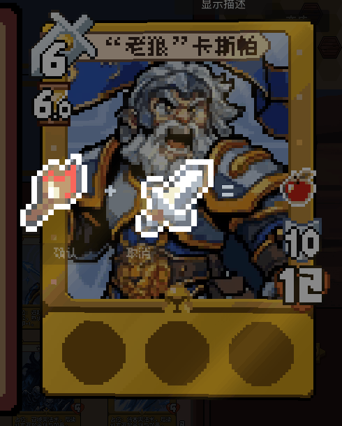

# 卡牌纹章合成：2026-10-14修订

## 当前操作流程

准备阶段打开随从检视，工具箱内的普通纹章可长按拖动或单击携带。卡牌上可合成的纹章呼吸紫光；工具箱内两枚纹章不能互相合成。落到卡上目标后，在目标右侧显示配方和确认／取消按钮。待确认时，目标纹章保持固定，手中材料与结果预览呼吸浮动。

公式完整纹章是检视4倍基础上再乘2，即原图8倍、112×112。右侧空间不足时，检视卡、公式和工具箱按相同位移与时长同步左移。让位完成后，吸附和融合阶段卡牌及目标原槽位置固定。

本轮按用户提供GIF的白色剪影形式更新确认演出：

1. 确认时复核材料与目标，消耗工具箱的一枚材料，在OwnedCard原槽建立全新结果实例；实际卡面暂时隐藏目标槽，由演出代画。
2. 两枚材料逐渐变为纯白剪影，保留原图透明轮廓；公式符号和结果预览淡出，同时手中材料向远离目标的方向后退原图2像素。
3. 手中纹章从后退终点缓慢起步、越来越快地撞向目标纹章，目标纹章的位置始终固定。两枚白色剪影在原槽重叠融合。
4. 原槽出现新纹章的白色剪影，逐渐恢复新纹章原色，并带两个细小像素十字闪点。新纹章向左受撞原图2像素，再回弹到原槽；删除原来覆盖卡面的大片白光。
5. 新纹章在原槽由8倍缩回正常4倍。落定时隐藏演出副本、交回卡面真实纹章，再使整张检视卡以最多2逻辑像素的幅度做衰减轻震。
6. 临时让位的卡牌与工具箱一起还原，恢复拖动。

确认前取消或右键／Esc会返还手中材料，保留卡上原纹章，不消耗金币或刮刀。确认后完成已提交结果的演出。连点只加速播放，不重复结算。

2026-10-15连点逻辑抽入`animation_click_speed.gd`，与三卡置换共用。两次左键按下间隔≤0.32秒时增加1.5倍，最高8倍；每次演出使用独立实例。等待公式确认时仍必须点击按钮，不会被连点自动确认。演出新建Tween时继承本次已加速的倍率。

首次遇见配方显示“？”，本局再次遇见显示具体结果；取消也算本局见过。成功合成才立即保存永久发现，全英雄共享。同结果的不同配方独立发现，高等级替代共享匹配到的配方编号。局内见闻保存在当前Main实例，永久发现随程序重启保留；局外解锁界面尚未实现。

## 数据与脚本职责

- `scripts/data/emblem_fusion_recipes.gd`：19条结构化配方，双向匹配、同系列高阶替代和最高结果优先。
- `scripts/data/emblem_sticker_inventory.gd`：`fuse_onto_card()`校验真实库存及OwnedCard原槽，替换新实例，清除旧材料成长。
- `scripts/ui/emblem_fusion_overlay.gd`：保管视觉副本和唯一Tween，`_first_rest`是目标原槽锚点，`_fusion_point`是固定吸附终点，`_result_rest`仅是等号右边的配方预览位置。
- `shaders/emblem_fusion_white.gdshader`：`white_amount`从0到1使图案变白，从1到0揭晓原色；只处理演出副本，不写回原图。
- `scripts/ui/emblem_fusion_sparks.gd`：绘制两枚向外飘散、逐渐消失的像素十字闪点。
- `scripts/ui/animation_click_speed.gd`：共用连点判定与Tween播放倍率；参数`DOUBLE_CLICK_SECONDS`、`SPEED_STEP`、`MAX_SPEED`统一控制纹章和三卡演出。
- `scripts/main.gd`：统一拖放、确认和结束；`landed`信号到达时恢复卡面的真实纹章，使纹章随整张卡一起轻震。
- `scripts/ui/inspection_card_surface.gd`：处理倾斜卡面命中和正逆投影，演出时冻结倾斜。
- `scripts/ui/card_view.gd`：`_fusion_hidden_emblem_slot`仅控制原槽的视觉交接，实例仍在OwnedCard中。
- `scripts/data/emblem_recipe_discovery.gd`：区分本局见闻和永久发现，永久文件为`user://emblem_recipe_discovery.json`。

## 初学者需要留意的写法

OwnedCard保存玩家拥有实例的状态，CardData是共享定义。`set_emblem_slot()`替换原槽并清理旧来源进度，不能把合成结果写入CardData。

吸附使用`progress * progress * progress`：相同时间增量下，起初位移小、接近目标时位移更大。只有手中材料执行`lerp()`位置插值，目标没有位置Tween，因此不会再次向中点漂移。

后退方向用`normalized()`把“目标到材料”的向量化成长度1，再乘原图距离与显示倍率。当前`2 × INSPECTION_ZOOM(4) × FORMULA_ZOOM(2) = 16`逻辑像素。`_move_result_recoil()`分别计算左移与回弹的时间进度，两段余弦缓动形成0→1→0的位移权重，只改变新纹章的横坐标，结束准确回到原槽。左移从原先约0.14秒放慢到0.24秒，回弹仍为0.14秒；恢复颜色和闪点继续独立并行播放。

`Tween.parallel()`同步白色渐变、背景压暗和公式淡出；`tween_callback()`串起吸附、揭晓、缩小、落定与轻震。`landed`先恢复真实纹章，再对整个已经合成好的检视卡纹理移动，避免卡牌震动而纹章停在原处。

连点组件继承`RefCounted`，只保存少量状态，无需添加场景节点。两处各调用`.new()`，所以共用的是代码和调参入口，每场动画的点击时间及当前倍率各自独立。

白色Shader使用`varying`传递顶点的颜色和透明度。Godot的fragment输入COLOR已包含纹理颜色，直接再乘会把纯白染回原色；因此另行保留顶点颜色，再对纹理颜色做白色混合，透明轮廓不变。依据[Godot CanvasItem Shader官方说明](https://docs.godotengine.org/en/stable/tutorials/shaders/shader_reference/canvas_item_shader.html#color-and-texture)。

投影使用与现有卡面Shader一致的正逆映射，不能把SubViewport内部纹章节点的global_position直接作为画布落点。

## 手工调试参数

参数都在演出脚本顶部，附同排中文说明：

- `FORMULA_BACKGROUND_BRIGHTNESS=0.60`：预览亮度。
- `CONFIRM_BACKGROUND_BRIGHTNESS=0.40`：确认后亮度。两者越小越暗，0全黑、1不额外压暗。
- 所有`_SECONDS`参数以秒为单位，数值越小播放越快。当前确认至结束约1.89秒；连点还可继续加速。
- `APPEAR_SECONDS=0.35`：两枚纹章放大抬起、公式出现及布局让位时长，原为0.65秒。
- `WHITE_SECONDS=0.16`：变白与材料后退时长；`ATTRACT_SECONDS=0.34`：从蓄力位置加速撞向目标的时长。
- `PULLBACK_PIXELS=2.0`、`RESULT_RECOIL_PIXELS=2.0`：材料后退、新纹章向左回弹的幅度，均按原图1倍像素填写，脚本自动换算。
- `FUSION_HOLD_SECONDS=0.07`：白色重叠短暂停留；`REVEAL_SECONDS=0.28`：新纹章恢复颜色与闪点消散时长。
- `RESULT_RECOIL_OUT_SECONDS=0.24`：新纹章向左移动的时长；`RESULT_REBOUND_SECONDS=0.14`：弹回原槽时长。分别调整，左移变慢不会拖慢回弹。
- `HOLD_SECONDS=0.16`：揭晓后停留；`RETURN_SECONDS=0.30`：结果缩回正常尺寸、布局还原及取消返还时长。
- `CARD_SHAKE_PIXELS=2.0`与`CARD_SHAKE_STEP_SECONDS`：整卡轻震幅度及每步时长。
- 十字闪点的大小、扩散距离与上浮距离在闪点脚本顶部。

## 验证与预览

2026-10-15抽出共用连点逻辑后，纹章真实2K交互59项全部通过，日志为`/private/tmp/project-card-emblem-shared-click-speed.log`。三卡共用加速专项另有58项通过，两处合计117项，Godot串行执行且均退出0；确认、取消、合成提交与归位流程保持正常。

使用真实场景、鼠标输入、OwnedCard和库存，没有mock；Godot进程串行执行并显式使用独立`--log-file`。本轮真实2K交互59项检查全部通过，覆盖原有交互及新增的材料后退、新纹章左移回弹，验证两种位移均按原图2像素换算为16逻辑像素、固定目标不移动、连点加速、缩小落定和整卡轻震。日志为`/private/tmp/project-card-emblem-fusion-recoil-verified.log`，进程退出码0。

单独放慢左移后，现有59项交互检查再次全部通过，日志为`/private/tmp/project-card-emblem-fusion-slow-left.log`，退出码0。退出清理时仍出现2个ObjectDB实例及1个资源残留提示，未定位来源。

新增的后退检查逐帧观察蓄力阶段，避免连点加速后固定延迟取样已进入撞击阶段。实际截图已核对融合、左移回弹、落定及卡牌轻震；下方为单独放慢左移前的真实演出录像，测试中已触发连点加速，当前时长以脚本为准。

此前额外属性回归仍有一项检视属性断言未通过：实例数值9、显示8、图标数量1。本轮不修改属性计算，保留为独立排查项。
