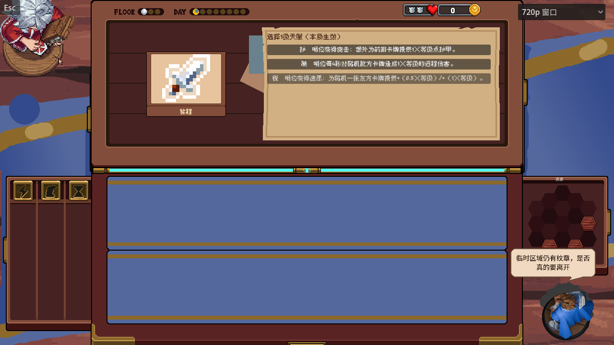
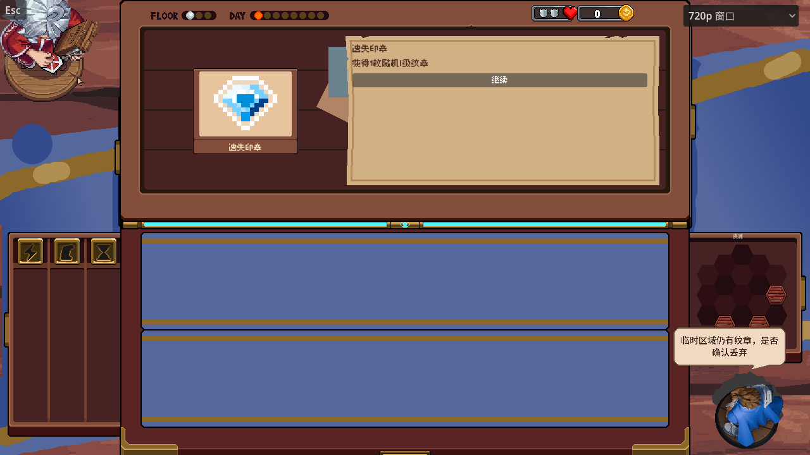
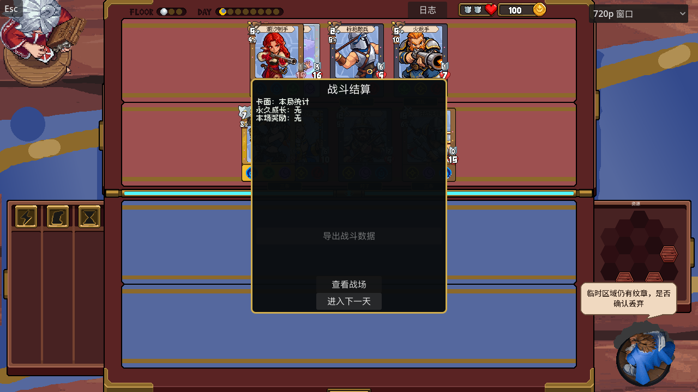

# 英雄说话与临时纹章退出确认

## 当前操作

商店、事件（含强化）及战斗结算退出时，如果临时区域仍有纹章，首次点击原按钮只让英雄说话；气泡有效期间，再点同一个按钮才确认丢弃并继续。商店文案为“临时区域仍有纹章，是否真的要离开”，事件与结算保留“临时区域仍有纹章，是否确认丢弃”。已删除原生丢弃确认窗口。

换点另一按钮、点击别处、按其他键、打开暂停、库存变化或新台词替换，都取消上次确认。默认从出现起5秒后收起；取消后再次操作需重新提示。确认后继续原库存、奖励、日期和存档事务，保存失败仍回滚；没有临时纹章时一次操作继续。

## 气泡与文字

使用用户提供的178×142px底板，宽度固定178px；高度根据完整文字在154px内容宽度内的实际换行数计算，加上内边距和尾尖。排版在逐字显示前完成，显示过程中高度不跳动。`NinePatchRect`保留原图边框、圆角与尾尖，只伸缩中间纯色区域；原始PNG没有修改。

台词采用14号深棕色黑体，默认在英雄头顶向上显示，仍沿用1280×720逻辑画布。每字间隔直接读取事件的`CHARACTER_SECONDS`（0.045秒），句段标点后读取`TEXT_LINE_PAUSE`（0.16秒）。气泡收起时整体0.20秒渐隐，取消当下即清除确认资格，淡出期间不能继续确认。新台词会停止旧的逐字和渐隐动画，防止旧回调把新话语藏掉。

## 从输入到结果

1. 原按钮调用自己的动作，例如事件`complete_event()`或结算`continue_after_battle()`。
2. `Main.confirm_temporary_sticker_discard()`检查临时纹章与气泡当前绑定的原按钮。首次显示气泡并停止；第二次点击同一按钮才放行。
3. 放行后走原事务，确认状态随即失效，气泡渐隐；事务失败恢复原数据，下次重新提示。

普通台词继续使用`main.hero_say("台词")`，第二个参数为停留秒数。普通台词不继承任何退出确认。

## 主要脚本与参数

- `scripts/ui/hero_speech_bubble.gd`：测量换行、九宫格背景、逐字演出、句段停顿、渐隐和英雄锚点；`confirmation_button`只保存当前有效原按钮，`_text_reveal`和`_fade`分别控制文字与收起动画。
- `scripts/main.gd`：共用英雄说话入口和临时纹章确认检查；商店只提供原离店按钮与文案，独立开发场景的结算也复用检查。
- `scripts/flow/short_maze_controller.gd`：事件／强化按钮通过`_exit_button()`把原按钮传给动作，战后结算复用原继续按钮，原有奖励及保存回滚不分叉。
- `scripts/ui/event_card_table.gd`：提供事件现有的逐字间隔和段间停顿，气泡直接引用这两个常量。

可调参数均有同排中文注释：`DEFAULT_SECONDS`为停留时间，`TEXT_INSET`为留白，`LINE_SPACING`为行间距，`FADE_SECONDS`为渐隐时长，`HEAD_INSET`与`SPEAKER_GAP`为头顶锚点。

## Godot写法说明

`TextParagraph`按固定内容宽度测量完整文字，`Label.visible_characters`只控制当前显示几个字，不改变外层尺寸。`Tween`按时间改变可见字数或整体透明度；收起先清空确认按钮，再播放渐隐，因此视觉淡出不会延长操作授权。

`NinePatchRect`的上下边缘保留区不拉伸，只有中央纯色部分改变高度。`mouse_filter = MOUSE_FILTER_IGNORE`让底板与文字不挡住按钮；取消提示不会吞掉玩家原来的点击。

`Callable.bindv()`按数组绑定原动作参数、确认状态和原按钮。连续调用`bind()`的参数组合顺序容易反向，这里先取出原参数，再明确附加，避免把按钮误传到布尔参数。

英雄位置通过`get_global_transform_with_canvas().affine_inverse()`换算到气泡父节点坐标系；气泡显示时跟随视角移动，收起后关闭逐帧及输入回调。`PROCESS_MODE_ALWAYS`允许暂停时完成清理与渐隐，不推进战斗。

## 验证

- `tests/hero_speech_exit_test.gd`：真实GPU55项通过，包含原商店25项，以及动态高度、逐字与句间停顿、渐隐中途替换台词、事件与强化原按钮、跨按钮重新提示、事件奖励不重复、战后确认及保存失败回滚。
- `tests/shop_event_pointer_animation_test.gd`：既有真实GPU46项通过，按钮工厂调整后普通事件／商店交互与动画保持。
- `tests/d2_8_maze_main_test.gd`：仍按“商店→免费事件→付费事件”的旧轮次运行，与当前“免费事件→付费事件→商店”不符，在第一天阶段断言及缺失`battle_seed`处中断，未计为通过；未扩展修改其旧流程假设。
- 此前旧工具箱回归另有2项重叠贴纸点击／拖拽预览失败，已在改动前基线复现；本次不扩展修改对应生产逻辑。未运行全量套件。

