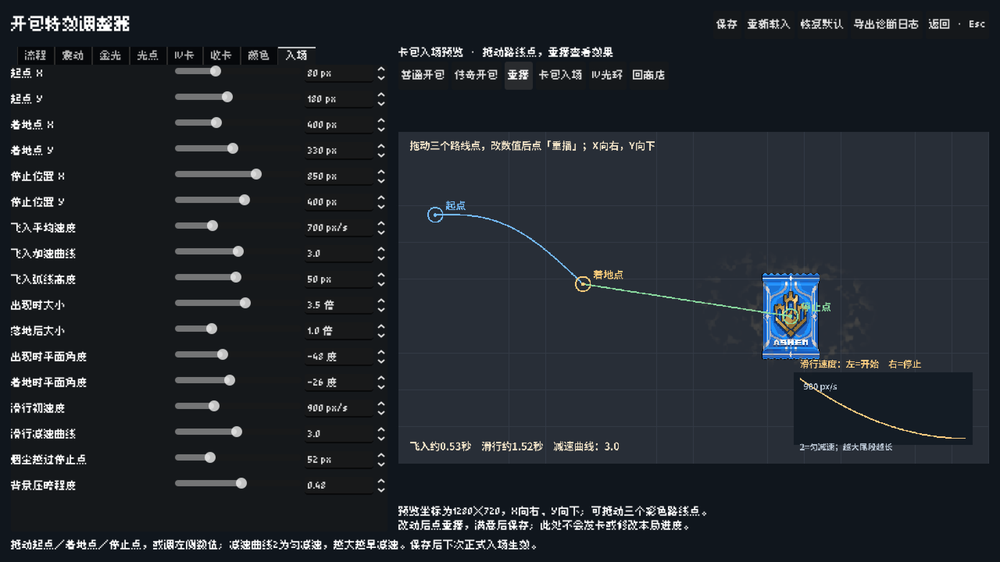

# 卡包入场调整器

入口：游戏内按Esc → 开发工具 → 开包特效调整器 → 点击右侧“卡包入场”。

## 使用顺序

1. 拖动右侧蓝色“起点”、黄色“着地点”、绿色“停止点”，或者修改左侧X/Y数值。
2. 调整速度、大小、角度和曲线，点击“重播”查看完整动画。
3. 满意后点击“保存”。正式游戏下次入场使用保存后的参数。

“重新载入”恢复上次保存值；“恢复默认”只改当前草稿，点击保存才覆盖文件。直接退出会丢弃未保存草稿。预览只播放包装，不发卡、不改变本局任务或已阅记录。

## 坐标与参数

坐标固定采用1280×720逻辑画布，X向右、Y向下，与窗口分辨率无关；三个点均表示包装中心。停止点设为X=640、Y=360就是正中心。画外起点的圆形标记会贴在画布边缘，输入框仍显示真实坐标。

| 参数 | 作用 |
| --- | --- |
| 起点X/Y | 刚出现的位置，可在画面外 |
| 着地点X/Y | 首次扬尘及开始滑行的位置 |
| 停止位置X/Y | 滑行最终停止的位置 |
| 飞入平均速度 | 沿飞入弧线的平均速度，越大越快 |
| 飞入加速曲线 | 1为匀速，数值越大越偏向后段加速 |
| 飞入弧线高度 | 0为直线，正值向上拱，负值向下弯 |
| 出现时／落地后大小 | 相对原包装图的倍率，滑行保持落地大小 |
| 出现时／着地时平面角度 | 负值逆时针，正值顺时针；滑行时回正 |
| 滑行初速度 | 刚着地时的滑行速度，单位为逻辑像素／秒 |
| 滑行减速曲线 | 2为匀减速；越大越早减速、尾段越长 |
| 烟尘越过停止点 | 烟尘铺过整段滑行路线，再越过停止后卡包边缘；默认额外36像素，可调至200；0恢复原环状效果 |
| 背景压暗程度 | 0不压暗，数值越大背景越暗 |

速度图左端代表滑行开始，右端代表停止；纵向显示当前速度与初速度的比例。图上标注初速度，底部显示预计飞入、滑行时长。滑行时长由距离、初速度与曲线共同决定，因此不会只改速度却仍强行套用旧时长。

## 实现与保存

参数集中在`pack_opening_effect_settings.gd`的“入场”组，保存到现有`user://pack_opening_effects.cfg`，与三份本局存档独立。`pack_arrival_animation.gd`是正式入场和预览共用的演出入口；`pack_arrival_preview.gd`只负责拖点、轨迹和速度图；原`pack_effect_tuner.gd`继续负责控件、保存及模式切换。

滑行位移使用`1-(1-t)^p`，归一化速度为`(1-t)^(p-1)`；停止时间为“距离×曲线指数÷初速度”。当p=2时，就是速度线性下降到零的匀减速。飞入时间由采样得到的弧线长度除以平均速度计算，改变弧线后时长也会更新。

Godot注意点：预览使用原生SubViewport，所以拖动时会自动换算缩放后的鼠标坐标。保存加载接口使用`load_saved()`，避开GDScript脚本资源自带的`reload(bool)`，防止外部调用意外重载脚本并重置配置路径。未保存草稿退出时，使用同一个加载接口恢复磁盘值。

烟尘随卡包滑行逐渐扩展，最后覆盖到停止后包装前缘之外；沿途椭圆形状合并为同一个外轮廓，中间留空，不显示相互重叠的小圆环。各路段仍按生成时间独立扩散、破碎、消散，左侧较早生成所以先淡出，末端在卡包停稳后继续消散约1.16秒。生成时刻沿用卡包的实际滑行时长与减速曲线，慢速滑行也不会提前清空烟尘。

入场脚本把扩散向量、滑行时长和减速指数交给烟尘组件。组件预先算好各路段的生成时刻，每帧只把存活烟团的中心、年龄和透明度传给着色器。着色器跳过超出可见范围的像素，再合并椭圆并绘制外缘。显示壳在首屏用一个透明色块预热同一份着色器，使首次绘制的准备工作提前发生。生成时间由滑行公式反推，`时长×[1-(1-路段比例)^(1/减速指数)]`，表示卡包何时经过该路段。包装尺寸与方向绝对值做点积，得到包装在滑行方向上的半宽，因此改包装大小或路线后，烟尘仍能越过包装边缘。
