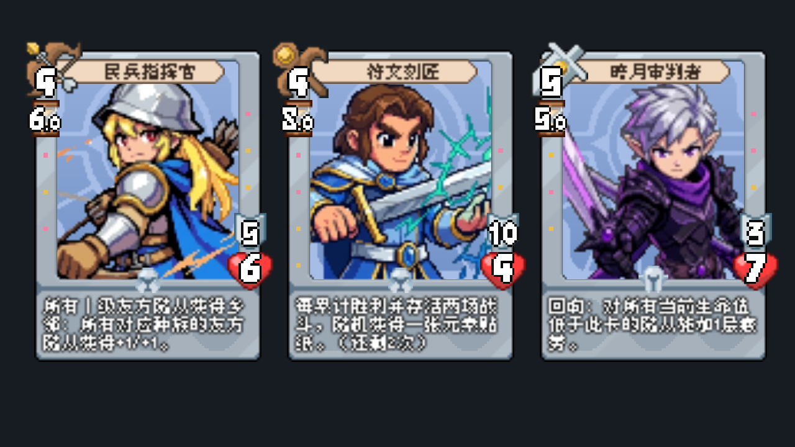

# 三卡平衡实现（2026-10-13）

依据本轮指令及用户对阵营、叠加、进度和元素池的补充确认，在主项目 `main` 实现。没有更改卡牌原有基础属性、卡图位置或通用槽位规则。

## 第一层：从效果到结果

民兵指挥官生效时，持续查询友方所有Ⅰ级效果来源；每个来源满足原有乡邻条件，就给全场对应种族的友军一份数值+1／生命+1。不同来源相加，老狼增加乡邻执行次数。站位、种族、沉默、影蔽及死亡变化后重新计算，撤销失效来源，不反复累积永久属性。

符文刻匠每次实际参战且胜利、战后存活、效果生效，独立进度加1；两场后发一张元素贴纸，进度归零继续循环。不是突击，也没有终身两张限制。卡面读拥有实例，显示“还剩2次→还剩1次→还剩2次”。失败不改变已有进度。进度和奖励先写待结算账本，标准结算提交后才改变收藏；重复提交不重复发奖，战斗中退出仍回到战前状态。

奖励复用纹章包抽取：五种普通元素贴纸为Ⅱ级、混沌／万能为Ⅲ级，当前品级权重13:2，即普通合计86.67%、特殊合计13.33%，各自品级内等概率。已经持有万能时特殊池只剩混沌；卡上、工具箱、待领取地面及同场刚产生的奖励均参与唯一校验。元素贴纸进工具箱占2×2；满包则留在地面，可以入包或贴入合法符文槽。NPC获胜时使用其自身一方的符文槽，不向玩家发奖。

暗月审判者每次回响读取自己的当前生命，对双方当前生命严格更低的存活、未放逐随从增加疲劳1。疲劳使用现有确定性战斗时钟；重复施加只加层数，不重置已经运行的疲劳计时。旧命中遮蔽纹章和相应到期队列已删除。

## 第二层：数据与脚本职责

- `resources/cards/militia_commander.tres`、`rune_engraver.tres`、`darkmoon_judge.tres`保存卡牌短文、效果ID与内容入口；`data/demo2/ash_ledger_effect_samples.json`、`silvermoon_effects.json`保存持续加成和回响定义。
- `scripts/battle/effects/battle_effect_runtime.gd`的计数查询复用乡邻判定与持续修正器，把每名合格Ⅰ级来源折算成一份加成。现有通用“授予效果”枚举尚无完整执行系统；这里复用已成熟的计数光环即可表达本卡行为，避免为一张卡新增另一套授予／撤销循环。
- `scripts/battle/battle_controller.gd`的 `_resolve_rune_engraver_progress()`在最终胜负确定、战斗清理之前读取实际拥有实例并登记进度和奖励。随机抽取直接复用 `OrdinaryShopService` 的候选过滤、品级权重与本场随机源。
- `scripts/data/owned_card.gd`的 `progress_by_source`以 `rune_engraver_wins`键保存已累计胜利次数，不新增第二份存档字段；`get_effect_text_for_row()`集中生成实例卡面文案，`CardView`统一读取。
- `scripts/battle/battle_owned_card_change_ledger.gd`新增通用 `set_progress`待结算记录；旧进度记录限定纹章实例，无法清楚承载随从自身的进度。`scripts/data/battle_settlement_service.gd`在完整校验后应用记录，沿用原战斗提交凭证及回滚。
- `scripts/data/run_reward_state.gd`、`scripts/main.gd`保留 `element_sticker`类型，从奖励到账、满包落地到入包／装备都按元素贴纸处理；本局保存沿用原结构。
- `scripts/battle/silvermoon_runtime.gd`负责审判者选目标；`twisted_vein_runtime.gd`的 `add_fatigue()`统一接入现有疲劳计时，矿脉哀嚎与暮光骑士也复用这一入口。
- 战斗实验室同步新说明，种族下拉补齐现有 `RaceType.NONE`。实验室只用CardData合成小队时没有跨战斗拥有实例，刻匠进度需使用实际游戏或本轮专项测试验证。

## 第三层：容易困惑的Godot写法

`CardData`是大家共用的卡牌定义，`OwnedCard`是一张真正拥有的卡。两个刻匠可以共用同一个 `.tres`，但必须在各自 `OwnedCard.progress_by_source`保存不同进度；修改公共资源会让所有同名卡一起变化。

`StringName`用于稳定的资源和进度键，中文显示文本用普通字符串。`Array[Dictionary]`是带类型约束的数组，使用 `assign()`复制已有内容时保留约束；避免条件表达式产生无类型空数组而在NPC分支触发赋值错误。

账本是一组“准备提交的变化”。战斗结束只记录，收藏恢复战前快照后统一提交；这让读档和重复调用不会多发奖励。`duplicate(true)`复制嵌套数据，避免测试快照、奖励候选和正式持有列表共享可变字典。

## 验证记录

- 三卡专项：75项，0失败。覆盖多来源及老狼叠加、阵营／种族筛选、失效撤销、0生命等待退场；双方当前生命比较、重复疲劳；四场胜利发两张并继续循环、重复提交、磁盘进度、万能唯一、同时奖励、满包落地／符文装备和NPC奖励。
- 银月战斗：467项，0失败；铁壁战斗：381项，0失败；扭曲矿脉战斗：272项，0失败。
- 战斗实验室回归通过；D2-5本局存档：13项通过，覆盖战中退出回滚、同名实例隔离、战斗身份恢复和一次性提交。
- 使用真实CardView进行图形截图检查：标题、全部卡面和刻匠剩余1次文案可见。
- 最后整理代码后重新运行三卡专项，仍为75项、0失败；`git diff --check`通过。
- Godot均显式指定 `/private/tmp/project-card-*.log`。一次初始回归短暂重叠，铁壁和矿脉之后已按顺序完整重跑；最终回归串行。部分含Main场景的测试退出仍有既有对象／资源残留警告，未报告为完全无警告。

较早版本的卡牌摘录和飞书原始快照保留追溯用途，当前规则入口为 `CARD_CHARACTER_DESIGN.md`本轮取代段及正式资源。本轮没有升级Godot、增加依赖或导出安装包。
