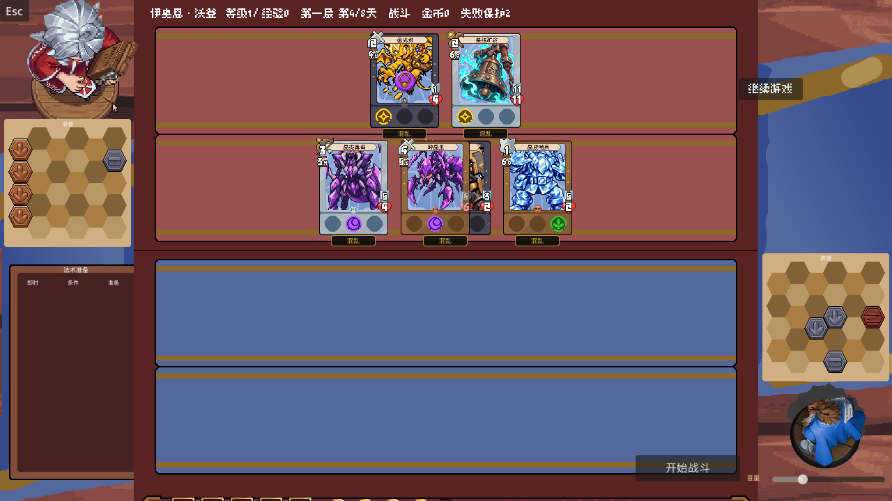

# 扭曲矿脉后续调试实施记录（2026-10-07）

本次按交接授权完成菜单输入、F2真实加卡和第一层敌方测试配置。保留主目录main既有修改，没有创建分支、worktree、并行代理或安装依赖。

## 第一层：功能从输入到结果如何运作

### Esc菜单与诊断导出

真实2560×1440图形窗口复现了原问题：前三个工具按钮收到鼠标位置时，Godot命中的是下方 `MazeFlowPanel` 的按钮或容器，菜单按钮没有发出pressed信号。导出按钮能打开文件框，但文件框在暂停时 `can_process()` 为false，取消控件无法响应。

根因分别是绘制与输入排序不一致，以及文件框继承Main的暂停处理模式。`z_index`使菜单画在后来创建的流程面板上方，却没有把鼠标命中顺序一起提升；更改菜单根控件的mouse_filter没有解决，候选改动已撤销。正式修复将菜单放到独立 `CanvasLayer`，让绘制与输入使用同一上层画布。工具按钮先关闭菜单并释放菜单持有的暂停，再打开工具；隐藏Main时也同步隐藏菜单画布，Esc仍可关闭工具。诊断文件框和导出结果提示使用 `PROCESS_MODE_ALWAYS`，导出和取消都保留菜单暂停，点击“返回”才释放它。

图形专项使用真实场景、SubViewport、鼠标与键盘事件，验证三个工具打开／Esc关闭、文件名输入、保存、取消、结果提示关闭与返回。没有调用按钮pressed.emit来替代这些图形输入。

### F2加入真实收藏

F2输入命令→Main查询完整卡牌注册表→为每张卡创建独立OwnedCard→同步收藏界面→保存完整本局。获得时随机确定符文、行动方式、槽位和资源形状；迷宫使用已保存的本局随机流。失败时恢复收藏、实例序号与随机流，不留下半次添加。IV级同名卡仍限制最多持有1张。仅准备阶段允许添加，法术、装备、资源加入收藏后仍须走各自的正式部署途径。

可用示例：

```text
card list twisted_vein
card list 晶壳
card add crystal_shell_beetle 3
card add 晶壳虫 x3
card add 矿道坍塌 2
card add ghost_pick
card add 彩金矿 2
```

省略数量时为1，支持 `3` 或 `x3`，一次1～100张。ID不区分大小写，中文名称完整匹配。未知ID／名称会明确反馈，可用card list筛选；卡包筛选复用CardPackRegistry，包含矿脉共用的4资源及矿镐，共36张。

### 第一层矿脉敌方

选敌方路径→按该路径已保存的battle_seed创建遭遇实例→组成合法小队并装备→资源按六边形禁用格、形状及占位校验部署→保存路径内encounter_state和资源板。开战把阵容、装备、敌方备好法术和资源传给正式BattleController；战斗副本负责本场变化。读档、UI恢复和重开使用已保存实例，不重新抽符文或晶壳虫行动。

12组候选遭遇按第1天、第2～3天、第4～7天、第8天分段，每段3组，候选内容合计覆盖24随从、5装备、3法术、4资源。每次只选一个候选，因此单局不保证见到全部36张。部分小队使用双卡紧密堆叠，顶牌与左右顺序分别显式配置；每排最多21单元，贪婪信徒始终单卡。矿铃保持无种族；晶壳虫的近战／防御保存在OwnedCard，不逐行动重抽。

遭遇资源属于配置提供的敌方关卡资源，额外部署在合法空格，不改通用自动资源0～3张的生成规则；空间不足时拒绝选择并回滚。现有自动资源的位置不重新排列。所有敌方实例与玩家收藏隔离，不把敌卡、装备或法术塞进玩家收藏。

这是覆盖测试内容，未固定为最终难度平衡。

## 第二层：关键数据、脚本与函数职责

- [Main](../scripts/main.gd)：创建EscapeMenuLayer、切换暂停与工具、管理FileDialog、接收F2命令、同步收藏与保存、把敌方备好法术交给战斗。`_restore_row_from_snapshot()`只对我方应用“装备必须属于玩家收藏”的清理，保留合法NPC装备。
- [EnemyEncounterBuilder](../scripts/flow/enemy_encounter_builder.gd)：纯数据生成与还原。`build()`验证卡牌类别、堆叠和排容量，生成独立OwnedCard；`restore()`复用正式存档解码还原小队和法术。旧的字符串建队不能表达实例随机、装备与法术，所以将这一明确职责拆出，继续复用SquadData、OwnedCard和RunSaveService。
- [ShortMazeController](../scripts/flow/short_maze_controller.gd)：`_build_enemy()`首次创建encounter_state，之后只还原；`get_enemy_prepared_spells()`返回独立敌方准备实例。路径选择失败走现有事务回滚。
- [RunSaveService](../scripts/data/run_save_service.gd)：存档增加独立enemy_collection，保存敌排成员与装备，并按阵营解码引用；不占用玩家OwnedCardCollection。路径内encounter_state还保存法术实例。沿用已有编码、解码与存档事务，不另建一套卡牌存档格式。
- [BattleController](../scripts/battle/battle_controller.gd)：已有NPC成员克隆保留揭晓状态，本次补齐NPC装备克隆。战斗消耗或进度变化不会污染战前装备，重开保留它。
- [遭遇配置](../data/demo2/short_maze_content.json)：`front/back`字符串表示单卡；对象的`cards`是左右顺序，`top`是顶牌索引，`layout`选择compact／expanded，`equipment`是装备位。`spells`与`resources`分别指定法术和资源。`first_day/last_day`控制可出现天数。

揭晓数量入口：配置的 `floor` 当前为1；`enemy_rune_reveals_by_floor` 当前为第一层1槽、第二层2槽、第三层3槽，支持0～3槽，按每张随从计算。修改只影响后续新生成遭遇；已保存的遭遇保留原实例。当前短路线仍只有第一层，后二层数值是预留配置。

`previous_formations`沿用已有旧存档接受机制并保留旧提示、阵容；新路径只用现行矿脉内容。

实际第四天遭遇画面：



## 第三层：不直观的Godot／GDScript写法

- `CanvasLayer`建立独立画布，适合模态菜单；它不继承Control的可见性，因此用Main的visibility_changed同步显隐。`z_index`只解决绘制排序，不能独自解决这次鼠标命中问题。
- `PROCESS_MODE_ALWAYS`让菜单与文件框在SceneTree.paused时仍能处理输入；Main和战斗保持原暂停逻辑。导出不会悄悄解除手动暂停、检视暂停等其他所有者。
- `.tres`的CardData是共享定义，OwnedCard才保存每个实例的随机结果。修改敌人的符文／行动必须改实例，不能改共享卡牌定义。
- `Array[OwnedCard]`要求元素类型一致。条件表达式中的普通空数组会丢失类型，非迷宫开战回归已定位这一问题；现在显式声明强类型数组，再用assign填入敌方法术。
- JSON读回整数会变成浮点数，快照验收先统一JSON类型再比较数值；它不是重新生成实例。正式解码会将行动、符文、数量等转换回所需整数与强类型数组。
- 同一battle_seed使用独立RandomNumberGenerator创建敌方实例，初次结果写入encounter_state；重开和读档从快照还原。这样界面刷新或战斗行动不会消耗获得时随机流。

## 验证与剩余范围

所有专项使用真实Godot 4.7.2和真实场景／数据，无mock。Godot验证串行启动，逐进程显式指定 `/private/tmp/project-card-<用途>.log`。没有执行全量套件。

| 专项 | 结果 |
| --- | --- |
| 新2K菜单图形输入 | 23项，0失败 |
| 新收藏与矿脉遭遇最终图形验收 | 227条，0失败 |
| 现有矿脉运行时 | 256条，0失败 |
| 现有矿脉Main图形验收 | 19条，0失败 |
| 现有本局存档 | 13项，通过 |
| 现有实例快照 | 26项，通过 |
| 现有法术准备及释放 | 65项，通过 |
| 现有符文覆盖与保存 | 17项，0失败 |
| 现有菜单启动还原 | 14项，0失败 |

新测试：[图形输入](../tests/escape_menu_input_test.gd)、[收藏／遭遇](../tests/twisted_vein_debug_test.gd)。覆盖未知卡与非法数量、真实键盘提交、保存失败回退、矿脉共用卡筛选、12组遭遇覆盖、五元素、层数揭晓配置、合法堆叠、NPC装备克隆、磁盘读档及未结算战斗重开。

部分无窗口Main旧测试仍打印证书读取及退出资源残留提示；图形Main与新增最终图形专项没有ObjectDB／资源残留提示。此前交接记录的4条旧资源规则冲突未改，也没有为它们恢复已取代规则。本次针对性回归没有断言失败。最终平衡与逐卡战斗观感仍需要人工游玩调参。
